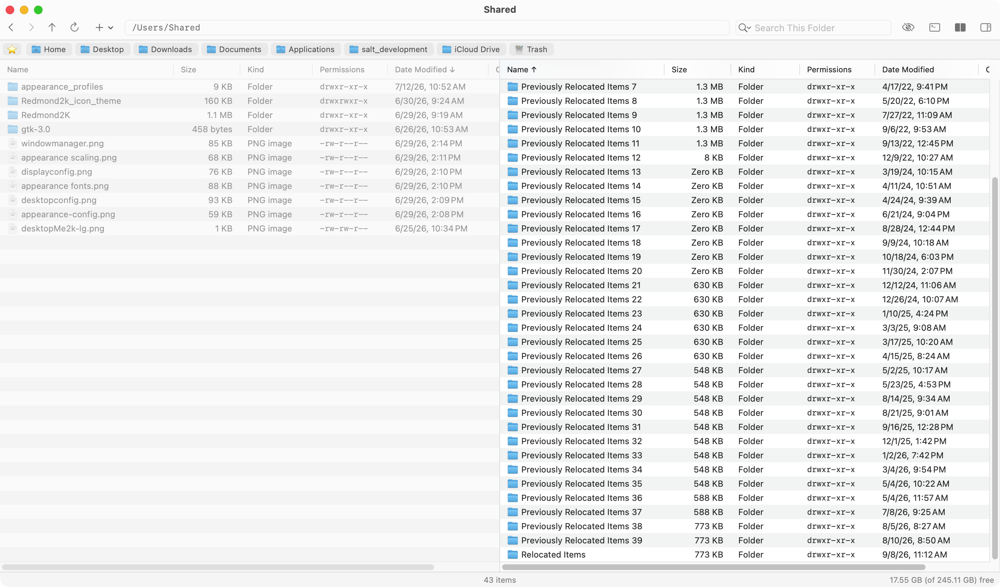

# files



A minimalist macOS file manager written in Objective-C + AppKit.

## Features

- List-view browser with Name, Size, Kind, Permissions and Date Modified
  columns; click a header to sort (folders first, Finder-style name order),
  right-click the headers to show or hide columns (every list follows)
- Auto-fit columns (View ▸ Auto-Fit Columns, on by default) and optional
  double-height rows with larger icons (View ▸ Large Rows)
- Single- or dual-pane browsing (View ▸ Dual Pane, ⇧⌘2; Tab switches panes)
- The status bar shows the item count and, on the right, the free and
  total space of the disk being browsed ("10.3 GB (of 245 GB) free"; free
  space counts purgeable space, as Finder does). View ▸ Show Used Disk
  Space (off by default; also in Preferences) shows the space used instead
  ("234.8 GB (of 245 GB) used"). A spinner at its left shows while a slow
  folder (e.g. a File Provider mount) is still loading
- Bookmarks bar (Home, Desktop, Downloads, Documents, Applications, Trash);
  ⌘D or the ★ button adds the current folder, and right-click ▸ Add to
  Bookmarks on a folder in the list adds that folder (before Trash, which
  is always last); right-click a bookmark to remove it. When the window
  is too narrow for every bookmark, scroll over the bar (mouse wheel or
  trackpad) to move along it. View ▸ Show Bookmarks Bar (on by default)
  hides or shows it in every window
- Quick Look: Space previews the selection (Space or Esc closes it; the
  arrow keys move through the list and the preview follows)
- Collapsible info sidebar with a Quick Look thumbnail and file details
- Get Info panel: kind, the app that opens the file, size, dates,
  owner/group, editable permissions, Locked flag, rename, and SHA-256 /
  MD5 checksums (Preferences ▸ Show Hashes in Get Info, off by default)
- Git folders: the top folder of a git working tree shows its usual folder
  icon with a git badge centered on it. Inside a repository the list gains
  a Git column that reads "tracked" for every file git tracks (including
  newly added ones) and every folder containing one, and is blank for
  untracked and ignored items; it updates when the index changes (add, rm,
  commit, checkout) and is filled in just after the list appears, so large
  repositories never hold up a folder. Git features need Xcode or the
  Command Line Tools and are off without them. The repository's Get Info
  panel adds a Git section: the current branch, whether it is pushed
  (compared with its upstream as of the last fetch — commits
  ahead/behind, no upstream, detached HEAD), and the remote URL (the
  upstream's remote, else origin)
- Copy, cut and paste, and drag and drop (moves by default; hold ⌥ to
  copy), with a progress panel (speed graph, transfer log, cancel), Keep
  Both / Replace prompts, and optional SHA-256 verification (View ▸
  Validate Copies with SHA-256). View ▸ Simple Copies (off by default)
  skips the panel: transfers run silently, keeping both on name clashes,
  and only errors are shown. Copies use APFS clones when possible and
  keep extended attributes, tags, ACLs, the Locked flag and dates; nothing
  at the destination is replaced until the new copy is complete. With
  validation on, each file is checked as soon as it is copied and the copy
  stops at the first mismatch; APFS clones share the original's data, so
  they are not re-read. Files kept only in iCloud are downloaded first,
  with their progress shown in the panel ("Downloading … from iCloud");
  moves within iCloud Drive need no download
- Move to Trash, Empty Trash, New Folder and New File (File menu or the
  toolbar's + button), Paste Into (right-click a folder while files are on
  the clipboard), inline rename (right-click ▸ Rename, and
  straight after New Folder / New File; the name without its extension is
  selected, ready to type). Return opens the selection, like a
  double-click: folders in the list, files in their default app
- App bundles open like folders; right-click ▸ Run Application launches one
- Symbolic links are followed (a link to a folder opens that folder)
- Opening a disk image (.dmg, .iso, …) mounts it and opens its volume in a
  new window; password-protected or licensed images are handed to the
  system's DiskImageMounter to ask, then open the same way
- Opening an archive (.zip, .tar, .tar.gz, .tgz) extracts it next to
  itself and opens the new folder in a new window: a folder named after the
  archive, or the archive's own top-level folder if it has just one; a name
  already taken gets " 2". Nothing appears until extraction is complete, and
  a failed one leaves nothing behind. An encrypted zip asks for its password
- Right-click ▸ Create Archive… on one or more items in the same folder asks
  for the format (zip, tar.gz or tar), the file name and, for zip, an
  optional password; the archive is made in that folder and selected.
  Passwords go to `zip` and `unzip` through a terminal, never on a command
  line where `ps` would show them. Zip password protection is the older
  ZipCrypto scheme, which is weak; tar cannot be password protected
- Spotlight search by name, in the current folder and its subfolders or
  across the whole Mac (the search field's magnifying-glass menu: This
  Folder / This Mac; the empty field shows which); the first 5,000 matches
  are shown, and the status bar says when there are more
- View ▸ Show Folder Sizes (off by default; also in Preferences): the Size
  column shows each folder's total — every file inside it, at any depth,
  added up (symbolic links not followed, other volumes not entered).
  Totals are counted in the background, one folder at a time, and fill in
  as they finish ("…" until then); sorting by Size uses them. They are
  kept while you stay in the folder; Reload counts them again
- Live updates when the current folder changes; a folder that cannot be
  read (no permission, a disconnected server) says so in the status bar.
  Folders are listed in the background, so a slow or unresponsive network
  folder never freezes the window
- While Files is the default file browser, expanding or creating an
  archive does not pop open a Finder window: Archive Utility's
  archive-reveal-after / dearchive-reveal-after are off (checked at every
  launch, including the first) and come back on with Set default file
  browser to Finder
- Mounts menu: mounted volumes, then cloud storage (iCloud Drive and
  File Provider accounts such as Google Drive); Go menu: Home, Desktop,
  Downloads, Documents and Trash
- An All Mounts panel with per-volume unmount; at the root
  of an unmountable volume (external disk, disk image, network share) a
  floating ⏏ button unmounts it (the status bar confirms), and any window
  showing it moves to /Volumes. If files on it are open, a sheet lists them
  (and the apps using them) and the volume unmounts automatically once
  they are closed
- Default file viewer in place of Finder: "Show in Finder" from other apps
  opens Files; Preferences ▸ Set default file browser to Finder undoes
  every change (see Replacing Finder)
- Preferences window (Files ▸ Preferences…, ⌘,): View has the View-menu
  preferences; Integration has the default file browser (Set default
  file browser to Files / to Finder — each opens a change log) and Keep
  Files running for faster startup (see Keeping Files running)
- About Files shows the version (from the `VERSION` file), build date,
  and links to camb.io and the license
- Address bar (accepts `~` and relative paths), back/forward/up, Open in
  Terminal, show/hide hidden files

## Prerequisites

- macOS 14.0 (Sonoma) or later
- Xcode Command Line Tools (`xcode-select --install`)

## Installation

```sh
make install
```

This builds the app bundle and copies it to `~/Applications/Files.app` (per-user; no `sudo` needed). Re-running `make install` replaces the previous copy.

To check a build first, `make test` runs the copy-engine tests (see BUILD.md).

## Full Disk Access

Files expects Full Disk Access (to show protected folders such as the Trash
and to change Archive Utility's settings). On launch it checks, and if access
is missing it explains how to grant it: System Settings ▸ Privacy & Security ▸
Full Disk Access, turn on Files (or add `~/Applications/Files.app` with +),
then Quit & Reopen.

The build signs with your first "Apple Development" certificate if you have
one (`security find-identity -v -p codesigning`), so the grant survives
rebuilds and `make install`. Without a certificate it falls back to an
ad-hoc signature, which macOS ties to a single build — the grant then has
to be given again after each install. To choose a specific identity:

```sh
make install CODESIGN_IDENTITY="Apple Development: Your Name (TEAMID)"
```

## First run

```sh
make run
```

Or double-click `Files.app` in `~/Applications` after installing.

## Replacing Finder

On first launch Files makes itself the default file viewer. It does not
replace or disable Finder, which macOS still needs. Instead it changes these
settings:

| Setting | Files sets | Effect |
|---------|------------|--------|
| `NSGlobalDomain NSFileViewer` | `com.cambio.files` | "Show in Finder" / "Reveal in Finder" in other apps (browser downloads, editors, System Settings' reveal buttons, `open -R`) opens Files, with the item selected in its folder |
| `com.apple.finder CreateDesktop` | `false` | Finder draws no desktop icons |
| `com.apple.finder QuitMenuItem` | `true` | Finder ▸ Quit Finder exists |
| `~/.zshrc` block between `# BEGIN Files: open folders in Files` and `# END Files: …` | an `open` shell function | `open <folder>` in Terminal opens Files. Anything else (files, options, `.app` and other packages) goes to the real `open`, as does a folder if Files can't be opened. Added only if zsh is your login shell, takes effect in new Terminal windows, and is removed when Finder is made the default again |
| `com.apple.archiveutility dearchive-reveal-after`, `archive-reveal-after` | `false` | Archive Utility opens no Finder window on what it expands or creates (needs Full Disk Access; set back to `true`, Archive Utility's default, when Finder is made the default again) |

Files quits Finder when it changes Finder's settings. Finder only reads
them at launch. It stays quit until something asks for it (its Dock icon,
the Dock's Trash, AirDrop, and so on), and then runs without desktop icons.

Files records each setting's original value (or that it was not set)
before changing it. Every launch re-checks the settings and puts back any
that something else reset.

Files can't become the default app for folders. The LaunchServices API
refuses (`LSSetDefaultRoleHandlerForContentType` returns `paramErr` for
`public.folder`). macOS 26 also ignores a `public.folder` entry written
straight into the `com.apple.launchservices.secure` preferences (the way
ForkLift documents), even after logging out and back in, and later drops
it. So Files doesn't write one.

This is a different request from a reveal. Revealing an item ("Show in
Finder", System Settings' reveal buttons) goes to the app named in
`NSFileViewer`, which is Files. Opening a folder (a Dock folder's "Open in
Finder", Return on a Spotlight folder result, an app opening a folder
rather than revealing it) goes to the default app for folders, which
stays Finder. In zsh, the `open` function sends `open <folder>` to Files.

A revealed folder opens to show its contents. macOS sends reveals as plain
"open" requests, so Files can't tell them apart. Hidden items are only
selected while hidden files are shown.

Some things still go to Finder, because macOS gives other apps no way to
take them:
- a folder another app opens rather than reveals: a Dock folder's "Open
  in Finder", a Spotlight folder result (the default app for folders)
- double-clicking a folder inside a Finder window
- the Finder and Trash icons in the Dock
- AirDrop and Connect to Server
- AppleScripts that name Finder

### Uninstalling

Before removing Files, open **Files ▸ Preferences…**, click **Set default
file browser to Finder**, and turn off **Keep Files running for faster
startup** so it is no longer a login item. Files writes every recorded setting back exactly as it was,
turns Archive Utility's reveal back on, and relaunches Finder. Then quit
Files and delete `~/Applications/Files.app`. **Set default file browser
to Files** switches back.

Either button opens a change log (in Console, from
`~/Library/Logs/Files/default-file-browser-<date>.log`) listing every
setting it checked or changed: its value before and after, the Terminal
command that makes the same change (`defaults write …`, or `cat >>` /
`sed` for the `~/.zshrc` function), and
whether the new value was confirmed by reading it back. The summary at
the end lists each check with the `defaults read` command that shows it.
Clicking the button for the current choice re-checks and repairs every
setting.

## Keeping Files running

By default Files quits when its last window closes, so the next "Show in
Finder" or opened folder has to launch it again. Turn on **Preferences ▸
Keep Files running for faster startup** (off by default) to have Files
behave like Finder:

- it stays open, without windows, after the last window closes, so the
  next window appears instantly
- clicking its Dock icon with no window open opens a home-folder window
- it is added to your login items and starts at login without opening a
  window (if you have turned Files off in System Settings ▸ General ▸
  Login Items, it asks you to turn it back on)
- each time it is used again with no windows open it repeats its launch
  checks: Full Disk Access, and the Finder / Archive Utility settings it
  manages

Only opening windows gets faster; browsing within a window is the same.
Turning the option off removes the login item. The login item points at
the copy of Files that was running when you turned the option on, so turn
it on from `~/Applications/Files.app`, not from a build in the project
folder.

## Keyboard shortcuts

| Action         | Shortcut           |
|----------------|--------------------|
| Copy           | ⌘C                 |
| Cut            | ⌘X                 |
| Paste          | ⌘V                 |
| New Window     | ⌘N                 |
| Preferences    | ⌘,                 |
| Find (search)  | ⌘F                 |
| New File       | ⌥⌘N                |
| Move to Trash  | ⌘⌫                 |
| Add Bookmark   | ⌘D                 |
| Open in Terminal | ⌘⇧T              |
| Dual Pane      | ⌘⇧2                |
| New Folder     | ⌘⇧N                |
| Get Info       | ⌘I                 |
| Select All     | ⌘A                 |
| Open           | Return             |
| Back           | ⌘[ or ←            |
| Forward        | ⌘] or →            |
| Home           | ⌘⇧H               |
| Desktop        | ⌘⇧D               |
| Downloads      | ⌘⇧L               |
| Documents      | ⌘⇧O               |

## License

BSD 3-Clause License. Copyright © 2026 Ian Campbell. See `LICENSE`.
