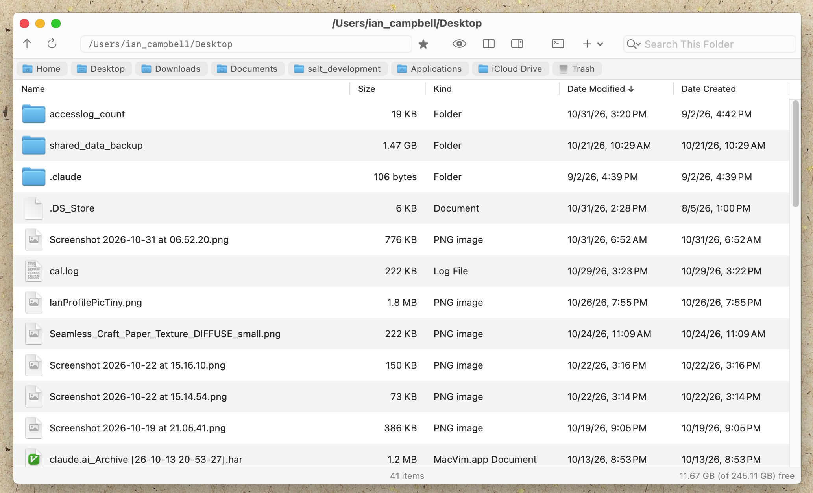

# Files



Files is a file manager that replaces Finder on macOS — a plain
Objective-C and AppKit app with no third-party dependencies. It browses
in one or two panes, shows the columns Finder won't (permissions, git
status, real folder sizes), and copies with APFS clones and optional
SHA-256 verification. "Show in Finder" from any other app opens Files
instead, and every setting it changes is recorded and reversible.

## Quickstart

**Prerequisites**

- macOS 14.0 (Sonoma) or later
- Xcode Command Line Tools: `xcode-select --install`

**Clone and build.** Files compiles in the `shared_ui` module, so check
both repositories out beside each other:

```sh
git clone https://github.com/IANatCAMBIO/Files.git files
git clone https://github.com/IANatCAMBIO/SharedUI.git shared_ui
cd files
make install
```

`make install` builds the bundle and copies it to `~/Applications/Files.app`
(per-user; no `sudo`). Re-running it replaces the previous copy.

| Command | What it does |
|---|---|
| `make` | build `Files.app` in the repo root |
| `make run` | build, then launch |
| `make install` | build, then install to `~/Applications` |
| `make test` | release checks (build, unit, feature, UI) |
| `make clean` | remove `build/` and the bundle |

See [BUILD.md](BUILD.md) for the toolchain, dependencies and test targets.

## First run

Launch from `~/Applications`, or `make run`.

**Full Disk Access.** Files needs it to show protected folders such as the
Trash and to change Archive Utility's settings. On launch it checks, and
if access is missing it explains how to grant it: System Settings ▸
Privacy & Security ▸ Full Disk Access, turn on Files (or add
`~/Applications/Files.app` with +), then Quit & Reopen.

**Code signing.** The build signs with your first "Apple Development"
certificate if you have one (`security find-identity -v -p codesigning`),
so the Full Disk Access grant survives rebuilds and `make install`.
Without a certificate it falls back to an ad-hoc signature, which macOS
ties to a single build — the grant then has to be given again after each
install. To choose a specific identity:

```sh
make install CODESIGN_IDENTITY="Apple Development: Your Name (TEAMID)"
```

**Default file browser.** On first launch Files makes itself the default
file viewer, so "Show in Finder" from other apps opens Files. It does not
replace or disable Finder, which macOS still needs. It changes a recorded
set of settings — `NSFileViewer`, Finder's desktop icons and Quit menu
item, an `open` function in `~/.zshrc`, and Archive Utility's reveal-after
flags — and quits Finder so they take effect. Every one is listed, with
its value before and after, in the change log that Preferences ▸
Integration opens. The full account is in
[USER_GUIDE.md § Replacing Finder](USER_GUIDE.md#replacing-finder).

## Uninstalling

1. Open **Files ▸ Preferences… ▸ Integration** and click **Set Finder as
   default**. Files writes every recorded setting back exactly as it was,
   turns Archive Utility's reveal back on, and relaunches Finder. A change
   log opens showing what it restored.
2. Turn off **Keep Files running for faster startup**, so Files is no
   longer a login item.
3. Quit Files and delete `~/Applications/Files.app`.

**Set Files as default** switches back at any time. Clicking the button
for the current choice re-checks and repairs every setting.

## Features

Compared with Finder:

- **Replaces Finder as the default file viewer** — reveals from other apps
  open Files with the item scrolled to and selected, and `open <folder>` in
  Terminal opens Files too. Reversible from Preferences, with a log of every
  setting touched
- **Dual-pane browsing** (⇧⌘2), Tab to switch, or open any folder in a
  split pane
- **Columns Finder doesn't have**: Permissions, Git status, Date Created,
  and real folder sizes (totalled in the background, sortable)
- **Copies you can trust**: APFS clones where possible, extended
  attributes, tags, ACLs and dates preserved, nothing replaced until the
  new copy is complete, and optional SHA-256 verification of every file —
  with a progress panel and a transfer log that records the hashes
- **Git-aware**: a badge on working-tree folders, a tracked/untracked
  column, and branch, push state and remote in Get Info
- **Get Info that tells you more**: editable permissions, owner and group,
  the Locked flag, and SHA-256 / MD5 checksums
- **Archives and disk images open in place** — double-click a `.zip`,
  `.tar.gz`, `.dmg` or `.iso` and the contents open in a new window; create
  archives (zip, tar.gz, tar, optionally password-protected) from the
  right-click menu
- **Set Default Apps** (Files ▸ Set Default Apps…) — every file type this
  Mac knows in one searchable, sortable list, with its icon and the app
  that opens it; double-click a row to repoint it, or follow the **change**
  link beside Opens with: in Get Info to land on a file's own type
- **A bookmarks bar** under the toolbar: ⌘D to add, drag to reorder
- **Mounts menu and one-click unmount**, including iCloud Drive and other
  File Provider accounts; if a volume is busy, Files names the files and
  apps holding it and unmounts as soon as they close
- **Never freezes on a slow volume** — listing, icons and column
  measurement all run off the main thread, so an unresponsive network
  share or File Provider mount doesn't lock up the window
- Spotlight search in the folder or across the Mac, Quick Look on Space,
  type-select, an address bar that takes `~` and relative paths, an info
  sidebar, and a status bar with item count and free disk space

Everything in detail — including keyboard shortcuts, the Finder settings
Files manages, and keeping Files running for faster startup — is in
[USER_GUIDE.md](USER_GUIDE.md).

## License

BSD 3-Clause License. Copyright © 2026 Ian Campbell. See `LICENSE`.
